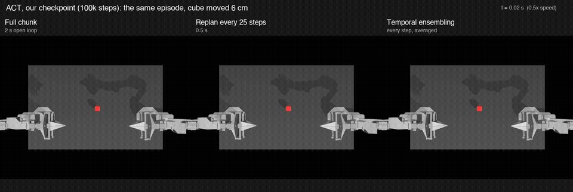

# ACT action chunking under delay and disturbance

How should a learned robot policy execute its action chunks when observations arrive late, or the
world changes mid-plan? This repository trains an ACT policy with
[Hugging Face LeRobot](https://github.com/huggingface/lerobot) on the ALOHA bimanual transfer-cube
task in simulation. It then measures five ways of executing ACT's 2-second chunks under two stresses:
observation latency (0–400 ms) and a mid-episode cube displacement (2–6 cm). There are 16,000 paired
episodes across two independently trained checkpoints, plus follow-up experiments that
explain the failure modes.



## Key findings (replicated on both checkpoints)

- **Temporal ensembling** makes ACT insensitive to up to 400 ms of latency. With ACT's default
  weights it does no better than open-loop chunks when the target moves. The defaults favor old
  predictions; **weighting recent predictions instead (coefficient −0.05) raises success after a
  6 cm move from 21–26.5% to 57.5–68%** and keeps the latency robustness, at a cost of 8–11
  points of nominal success.
- **Replanning every 0.5 s** is the only mode that recovers from a 6 cm move: 61–68% success
  against 18–27% for the other modes. It pays for this with the largest latency penalty
  (−17 to −20 points at 400 ms).
- **Replanning every 0.2 s** collapses to about 6% success because the arm dithers in place: 40%
  of full-chunk speed and 10–15% path efficiency. Latency makes it *better*, because time alignment
  skips the start of each chunk.

| Mode | Nominal | 400 ms latency | 6 cm displacement |
|---|---|---|---|
| Full chunk (2 s open loop) | 75 / 81% | 71.5 / 69% | 18.5 / 20% |
| Replan every 25 steps (0.5 s) | 73.5 / 75% | 54 / 58% | **61.5 / 68%** |
| Temporal ensembling | 74.5 / 71% | **77 / 68%** | 21 / 26.5% |
| Replan every 10 steps (0.2 s) | 6 / 6.5% | 12 / 15% | 3.5 / 6.5% |

*Each cell: our checkpoint / the official LeRobot checkpoint, 200 paired seeds.*

The one-page writeup, [WRITEUP.md](WRITEUP.md), covers the method, statistics, failure analysis
and limitations. [DEVLOG.md](DEVLOG.md) records every decision, command and piece of evidence in
order.


## Baseline

- **Retraining.** ACT was retrained with the official recipe (100k steps, 3.3 h on one L4).
  It reaches 74.5% nominal success.
- **Official checkpoint reproduced.** The released checkpoint scores 83.4% on the same 500 seeds
  as its published 83.0% (472/500 identical outcomes).
- Training curve and checkpoint evaluation: [results/day02/figures/checkpoints.png](results/day02/figures/checkpoints.png).

## Repository layout

| Path | Contents |
|---|---|
| `scripts/chunk_eval.py` | The experiment harness. It runs LeRobot's evaluator with a `ChunkExecutor` (full chunk / replan k / temporal ensembling under time-aligned observation latency) and a `CubeDisplacement` gym wrapper. |
| `scripts/test_chunk_executor.py` | Simulator-free unit test of chunk time alignment (20 cases). |
| `scripts/compare_harness.py` | Validation of the harness against `lerobot-eval` on identical seeds. |
| `scripts/summarize.py` | Tables (Wilson CIs, paired McNemar tests, failure stages) and figures. |
| `scripts/analyze_trajectories.py`, `scripts/chunk_profile.py` | Mechanism analyses (arm kinematics, chunk velocity profile). |
| `scripts/make_video.py` | Side-by-side demo video. |
| `scripts/jobs/` | Hugging Face Jobs scripts used for training, validation and every experiment grid. |
| `results/` | Summaries, figures and the demo video. The per-episode results live in the dataset repo on the Hub. |

## Reproduce

```bash
brew install uv ffmpeg   # macOS; on Linux, install ffmpeg with your package manager
git clone https://github.com/huggingface/lerobot.git lerobot
cd lerobot && git checkout e595b7902714ba51f91e47523f66f89c5181b649
uv python install 3.12 && uv sync --locked --python 3.12 --extra training --extra aloha
source .venv/bin/activate && cd ..

# Unit test (no simulator)
python scripts/test_chunk_executor.py

# Evaluate a checkpoint locally on a few seeds, e.g. replanning every 25 steps with a 6 cm cube move
python scripts/chunk_eval.py --checkpoint <pretrained_model dir> --grid core --only replan25_d00_m6 \
  --seeds 1000:1010 --block 5 --n-envs 5 --workers 2 --device mps --out out/example
```

The full grids ran on Hugging Face Jobs (`t4-medium`). See `scripts/jobs/run_grid.sh` for the exact
submit command and settings. They are deterministic kernels, displacement window 50–75, 7 workers × 5 envs, and
200 seeds per condition.

## Acknowledgments

This study builds on LeRobot, the ALOHA simulation environments (gym-aloha), and ACT
(Zhao et al., *Learning Fine-Grained Bimanual Manipulation with Low-Cost Hardware*, 2023). The
latency question is motivated by Real-Time Chunking (Black et al., 2025).
