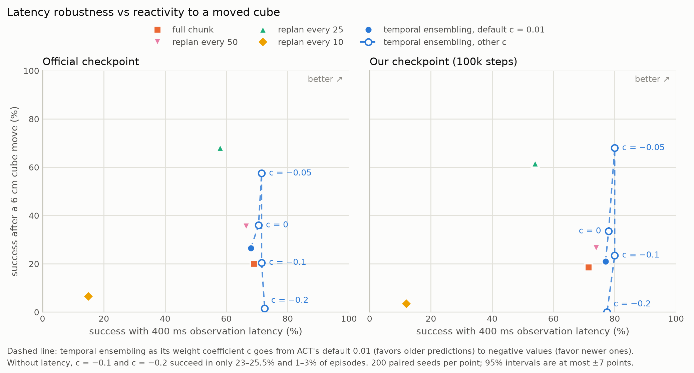
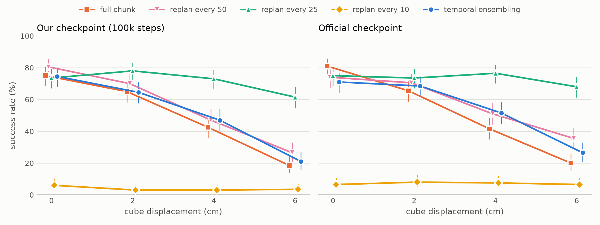
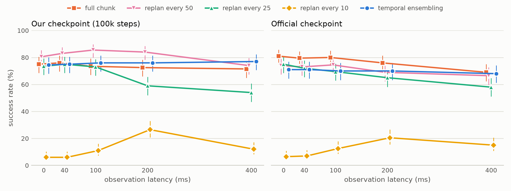

# ACT action chunking under delay and disturbance

How should a learned robot policy execute its action chunks when observations arrive late, or the
world changes mid-plan? This repository trains an ACT policy with
[Hugging Face LeRobot](https://github.com/huggingface/lerobot) on the ALOHA bimanual transfer-cube
task in simulation. It then measures five ways of executing ACT's 2-second chunks under two stresses:
observation latency (0–400 ms) and a mid-episode cube displacement (2–6 cm). There are 16,000 paired
episodes across two independently trained checkpoints, plus follow-up experiments that
explain the failure modes.



## Key findings (replicated on both checkpoints)

- **Temporal ensembling** makes ACT insensitive to up to 400 ms of latency. With ACT's default
  weights it is barely better than open-loop chunks when the target moves (+2.5 to +6.5 points,
  not significant). The defaults favor old predictions; **weighting recent predictions instead
  (coefficient −0.05) raises success after a 6 cm move from 21–26.5% to 57.5–68%** and keeps the
  latency robustness, at an estimated cost of 8–11 points of nominal success (not significant
  after correction). The useful range is narrow: at −0.1 and −0.2, success without latency
  collapses to 23–25.5% and 1–3%.
- **Replanning every 0.5 s** is the only one of the five base modes that recovers from a 6 cm move:
  61.5–68% success, against 18.5–26.5% for full chunks and default ensembling. It pays for this
  with the largest latency penalty (−17 to −20 points at 400 ms).
- **Replanning every 0.2 s** collapses to about 6% success because the arm dithers in place: 40%
  of full-chunk speed and 10–15% path efficiency. Latency makes it *better*, because time alignment
  skips the start of each chunk.

| Mode | Nominal | 400 ms latency | 6 cm displacement |
|---|---|---|---|
| Full chunk (2 s open loop) | 75 / 81% | 71.5 / 69% | 18.5 / 20% |
| Replan every 25 steps (0.5 s) | 73.5 / 75% | 54 / 58% | **61.5 / 68%** |
| Temporal ensembling (ACT default weights) | 74.5 / 71% | 77 / 68% | 21 / 26.5% |
| Replan every 10 steps (0.2 s) | 6 / 6.5% | 12 / 15% | 3.5 / 6.5% |
| Temporal ensembling, recency-weighted (c = −0.05) | 66.5 / 60% | **80 / 71.5%** | **68 / 57.5%** |

*Each cell: our checkpoint / the official LeRobot checkpoint, 200 paired seeds.*


All 35 paired tests behind these claims were corrected together for multiple comparisons
([results/stats/multiple_comparisons.md](results/stats/multiple_comparisons.md)). The writeup
says where a claim does not survive the correction.

The one-page writeup, [WRITEUP.md](WRITEUP.md), covers the method, statistics, failure analysis
and limitations. [DEVLOG.md](DEVLOG.md) records every decision, command and piece of evidence in
order.




## Baseline

- **Retraining.** ACT was retrained with the official recipe (100k steps, 3.3 h on one L4).
  It reaches 74.5% nominal success.
- **Official checkpoint reproduced.** The released checkpoint scores 83.4% on the same 500 seeds
  as its published 83.0% (472/500 identical outcomes).
- Training curve and checkpoint evaluation: [results/day02/figures/checkpoints.png](results/day02/figures/checkpoints.png).

## Repository layout

| Path | Contents |
|---|---|
| `scripts/chunk_eval.py` | The experiment harness. It runs LeRobot's evaluator with a `ChunkExecutor` (full chunk / replan k / temporal ensembling under time-aligned observation latency) and a `CubeDisplacement` gym wrapper. |
| `scripts/test_chunk_executor.py` | Simulator-free unit test of chunk time alignment (20 cases). |
| `scripts/compare_harness.py` | Validation of the harness against `lerobot-eval` on identical seeds. |
| `scripts/summarize.py` | Tables (Wilson CIs, paired McNemar tests, failure stages) and figures. |
| `scripts/tradeoff.py` | The headline trade-off figure and the ensembling-coefficient table. |
| `scripts/multiple_comparisons.py` | Holm and Bonferroni correction of every paired test behind the claims. |
| `scripts/analyze_trajectories.py`, `scripts/chunk_profile.py` | Mechanism analyses (arm kinematics, chunk velocity profile). |
| `scripts/make_video.py` | Side-by-side demo video. |
| `scripts/jobs/` | Hugging Face Jobs scripts used for training, validation and every experiment grid. |
| `results/` | Summaries, figures and the demo video. The per-episode results live in the dataset repo on the Hub. |
| `hub/` | The model and dataset cards of the Hugging Face repos. |

## Reproduce

Setup. LeRobot is pinned to the commit used for every run:

```bash
brew install uv ffmpeg   # macOS; on Linux, install ffmpeg with your package manager
git clone https://github.com/DiyunZ/act-chunking-study.git && cd act-chunking-study
git clone https://github.com/huggingface/lerobot.git lerobot
cd lerobot && git checkout e595b7902714ba51f91e47523f66f89c5181b649
uv python install 3.12 && uv sync --locked --python 3.12 --extra training --extra aloha
source .venv/bin/activate && cd ..
```

Check the harness, then run a two-episode evaluation (a few minutes on a laptop):

```bash
python scripts/test_chunk_executor.py   # time-alignment unit test, no simulator

# Our 100k-step checkpoint from the Hub...
hf download FTG64/act_aloha_transfer_cube --revision 100000 \
  --include "checkpoints/100000/pretrained_model/*" --local-dir checkpoints/ours
# ...or the official checkpoint, converted to LeRobot's current processor format
python lerobot/src/lerobot/processor/migrate_policy_normalization.py \
  --pretrained-path lerobot/act_aloha_sim_transfer_cube_human --output-dir checkpoints/official

# Replan every 25 steps with a 6 cm cube move (use --device cuda or cpu off macOS)
python scripts/chunk_eval.py --checkpoint checkpoints/ours/checkpoints/100000/pretrained_model \
  --grid core --only replan25_d00_m6 --seeds 1000:1002 --block 2 --n-envs 2 --workers 1 \
  --device mps --out out/example
```

Rebuild the tables and figures from the published per-episode results:

```bash
hf download FTG64/act-chunking-study --repo-type dataset --include "results/core_*" \
  --include "results/te_weights_*" --include "results/ckpt_*" --local-dir outputs/hub
uv run --no-project --with numpy --with matplotlib python scripts/summarize.py \
  --runs outputs/hub/results/core_ours100k outputs/hub/results/core_official --out results/core/both
uv run --no-project --with numpy --with matplotlib python scripts/tradeoff.py \
  --results outputs/hub/results --out results/tradeoff
uv run --no-project --with numpy --with matplotlib python scripts/multiple_comparisons.py \
  --results outputs/hub/results --out results/stats
```

Run a full grid on Hugging Face Jobs. Upload the scripts to your own dataset repo first; results
sync back to it:

```bash
hf upload <you>/act-chunking-study scripts code/scripts --repo-type dataset
hf jobs run --detach --flavor t4-medium --timeout 5h --secrets HF_TOKEN --name act-core-official \
  -e REPO=<you>/act-chunking-study -e CKPT=official -e LABEL=official -e RUN=core_official \
  -e GRID=core -e SEEDS=1000:1200 huggingface/lerobot-gpu:latest bash -c "$(cat scripts/jobs/run_grid.sh)"
```

One core grid (40 conditions × 200 seeds) takes about 4 h on `t4-medium`, roughly $2.40. A job
resubmitted with the same `RUN` skips finished tasks. Every grid used deterministic GPU kernels, the
displacement window 50–75, and 7 workers × 5 environments. `scripts/jobs/run_grid.sh` lists all
settings.

Training. This is the exact command of the 100k-step run on `l4x1`:

```bash
lerobot-train --dataset.repo_id=lerobot/aloha_sim_transfer_cube_human --dataset.video_backend=pyav \
  --policy.type=act --policy.repo_id=<you>/act_aloha_transfer_cube --batch_size=8 --steps=100000 \
  --save_freq=25000 --log_freq=200 --num_workers=4 --save_checkpoint_to_hub=true \
  --wandb.enable=false --seed=1000 --output_dir=outputs/train/act_aloha_transfer_cube \
  --job_name=act_aloha_transfer_cube --job.target=l4x1 --job.timeout=8h --job.detach=true
```

## License and citation

The code is MIT-licensed ([LICENSE](LICENSE)). The model weights on the Hub keep LeRobot's
Apache-2.0 license. To cite this study, use [CITATION.cff](CITATION.cff).

## Acknowledgments

This study builds on LeRobot, the ALOHA simulation environments (gym-aloha), and ACT
(Zhao et al., *Learning Fine-Grained Bimanual Manipulation with Low-Cost Hardware*, 2023). The
latency question is motivated by Real-Time Chunking (Black et al., 2025).
