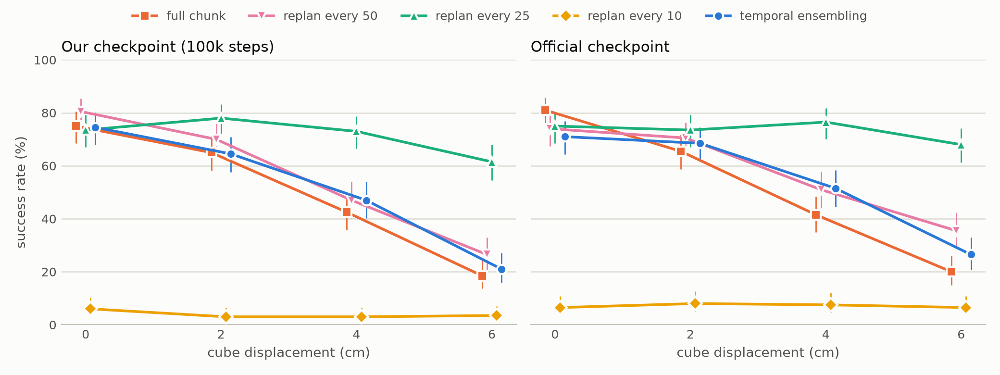
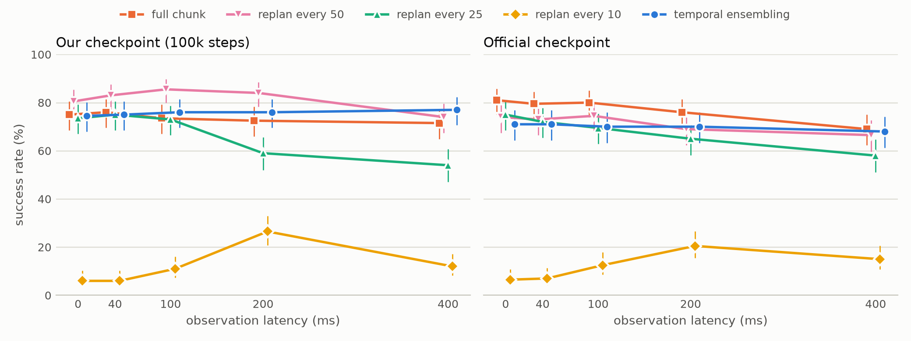

# Action chunking under delay and disturbance

*An imitation-learning study with Hugging Face LeRobot. Diyun Zheng, September 2026.*

## Question

ACT predicts 2 s of actions from each camera frame. The question is how those chunks should be
executed when observations arrive late or the world changes during execution. Five execution modes
were compared on two independently trained ACT checkpoints, under two conditions: observation
latency of 0–400 ms, and a mid-episode displacement of the target of 2–6 cm.

## Setup

- **Task.** ALOHA bimanual transfer cube in simulation (MuJoCo via gym-aloha). The right arm picks
  up a cube and hands it to the left arm. Control runs at 50 Hz, episodes last 8 s, and an episode
  succeeds when the left gripper holds the cube off the table.
- **State and action.** The observation is one 480×640 top-camera image plus the 14-D joint state
  (two 6-DOF arms and two grippers). The action is 14 absolute joint-position targets, and each
  prediction is a chunk of 100 actions (2 s).
- **Policy.** ACT was chosen for three reasons:
  - it is the policy introduced with ALOHA and LeRobot's standard single-task baseline;
  - action chunking is exactly what the study varies;
  - it trains in about 3 h on one GPU.

  Diffusion Policy and SmolVLA also chunk, but they would add a sampling or language component
  that is not under study here.
- **Data and training.** The dataset is `lerobot/aloha_sim_transfer_cube_human`: 50 human
  demonstrations, 20k frames. Training followed the official recipe: 100k steps, batch 8, AdamW
  at lr 1e-5, KL weight 10, ResNet-18 backbone. It took 3.3 h on an L4 through Hugging Face Jobs.
  The retrained model reaches **74.5%** on 200 seeds, against 81.5% for the released checkpoint on
  the same seeds (exact McNemar p = 0.054). The released checkpoint was also reproduced: **83.4%**
  over 500 seeds against its published 83.0%, with 472/500 identical outcomes. Success keeps rising
  up to 100k steps: 25k steps (10 epochs) give only 53.5%.

## Method

- **Execution modes.**
  - Full chunk: execute all 100 actions (100 − d under latency).
  - Replan every 50, 25 or 10 steps.
  - Temporal ensembling: predict every step and average with ACT's weights, coefficient 0.01.
- **Latency.** At step t the policy only sees the frame from step t − d, and every chunk is
  time-aligned, starting at the index for "now". This is dead time in the control loop.
  d ∈ {0, 2, 5, 10, 20} steps, i.e. 0–400 ms.
- **Displacement.** The cube is teleported 2, 4 or 6 cm, in a random direction that stays inside
  the training region, at a random step between 50 and 75. That is before first contact in all
  6,800 displaced episodes, and the arms are verified untouched on every move.
- **Harness.** A thin layer on LeRobot's own evaluator. It matches `lerobot-eval`'s success count
  to within one episode in all four modes tested (per-episode outcomes agree on 43–50 of 50 seeds). GPU runs are
  reproducible at the outcome level but not at trajectory level, and this is also true of
  `lerobot-eval` itself.
- **Statistics.** Each condition uses the same 200 seeds, which allows paired exact McNemar
  tests; intervals are 95% Wilson intervals. The main grid is 40 conditions × 2 checkpoints =
  16,000 episodes. On top of that come 2,400 episodes for the ensembling-weight test and 500
  with logged arm trajectories, all on T4 GPUs through Hugging Face Jobs. Total cloud cost for the project, training included, was about $11.

## Results

| Mode | Nominal | 400 ms latency | 6 cm displacement |
|---|---|---|---|
| Full chunk | 75 / 81% | 71.5 / 69% | 18.5 / 20% |
| Replan every 25 | 73.5 / 75% | **54 / 58%** | **61.5 / 68%** |
| Temporal ensembling | 74.5 / 71% | **77 / 68%** | 21 / 26.5% |
| Replan every 10 | 6 / 6.5% | 12 / 15% | 3.5 / 6.5% |

*Each cell is our checkpoint / the official checkpoint, n = 200.*

Findings that hold on both checkpoints:

1. **Temporal ensembling makes ACT insensitive to latency** up to 400 ms (0 → 400 ms: p = 0.38 and
   0.21). It rejects a moved target no better than full-chunk execution (at 6 cm: p = 0.53 and
   0.10).
2. **Replanning every 0.5 s is the only mode that recovers from a 6 cm move.** On the same seeds it
   beats full chunk 97:11 and 106:10 (p < 1e-17). It also pays the largest latency penalty,
   −17 to −20 points at 400 ms, and is worse than full chunk there (p < 0.02).
3. **Replanning every 0.2 s collapses to about 6%, and latency makes it better** (6% → 26.5% at
   200 ms, p < 1e-4).
4. **Ensembling's lack of reactivity comes from its default weights.** Weighting recent predictions
   (coefficient −0.05 instead of 0.01) raises success at 6 cm from 21–26.5% to 57.5–68% and keeps
   the latency robustness. The cost is 8–11 points of nominal success.

Two results depend on the checkpoint: whether full-chunk execution degrades with latency (official
p < 0.001, ours p = 0.34), and how the modes rank without latency.

## Why the modes fail

- **Moved target.** At 6 cm, 72–90 of the failed full-chunk and ensembling episodes per model never
  touch the cube: the arm completes the plan made for the old position. With replan 25, only 12–23
  failures are of this kind.
- **Replan every 10 steps: the arm dithers in place.** Closed-loop logs over 50 seeds per model
  show why:
  - joint speed is about 40% of full chunk;
  - path efficiency (net displacement / path length) is 0.10–0.15, against 0.53–0.59;
  - direction reversals are 50% more frequent;
  - at 1.5 s the gripper is 0.34–0.35 m from the cube (median), slightly farther away than at the
    start (0.33 m).

  Re-anchoring a new chunk on the current state every 10 steps keeps restarting the reach. The
  open-loop chunk profile (first 10 actions only 8–21% slower) does not explain this on its own.
  With 200 ms latency, time alignment executes chunk indices 10–19; speed and efficiency recover,
  and failures move to the handover stage (122–144 episodes lift the cube but never hand it over).
- **Handover.** Of the 7,324 failed episodes across all 80 conditions, none got as far as
  left-gripper contact. Every failure is a missed cube, a failed lift, or a lift with no handover
  attempt.
- **Why ensembling does not react: its weights favor old plans.** ACT averages all predictions
  for the current step with weights exp(−c·i), where i = 0 is the oldest. The default c = 0.01
  weights old predictions most, so after the cube moves, the executed action is still dominated by
  plans made before the move. Changing only c, on the same 200 seeds (official / ours):

  | TE weight coefficient | Nominal | 6 cm displacement | 400 ms latency |
  |---|---|---|---|
  | +0.01 (ACT default, favors old) | 71 / 74.5% | 26.5 / 21% | 68 / 77% |
  | 0 (uniform) | 71.5 / 78.5% | 36 / 33.5% | 70.5 / 78% |
  | −0.05 (favors recent) | 60 / 66.5% | **57.5 / 68%** | **71.5 / 80%** |

  - Favoring recent predictions restores reactivity: 21–26.5% → 57.5–68% at 6 cm
    (p < 1e-9, both models).
  - It keeps the latency robustness (400 ms: n.s. against the default).
  - It costs 8–11 points nominally (p = 0.012 and 0.072).
  - At c = −0.05, ensembling beats replan 25 under 400 ms latency (143 vs 116 and 160 vs 108
    successes, p < 0.001). Under displacement it is below replan 25 on the official checkpoint (115
    vs 136, p = 0.007) and level on ours (136 vs 123, p = 0.11). Its worst case over the
    three conditions is the best of any mode on our checkpoint (66.5%, against 54% for replan 25)
    and ties replan 25 on the official one (57.5% vs 58%).

## Limitations

- Simulation only, one task, and a single training run of our checkpoint.
- Latency is modeled as perfectly time-aligned observation delay; a real asynchronous system also
  has inference jitter.
- The displacement is a teleport, not a physical push.
- GPU evaluation is reproducible only at the outcome level.

## Next steps

- Tune the ensembling coefficient per task, or make it adaptive: favor recent predictions only
  when the observation changes unexpectedly.
- Compare with inference-time methods that keep reactivity under latency, such as Real-Time
  Chunking (Black et al., 2025).
- Train with latency and perturbation augmentation.
- Repeat the latency and displacement protocol on a real SO-101 arm.
